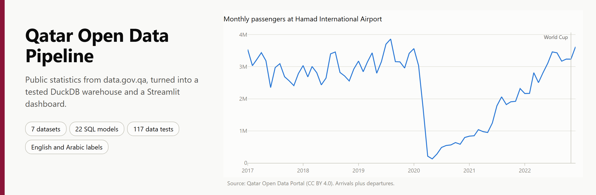
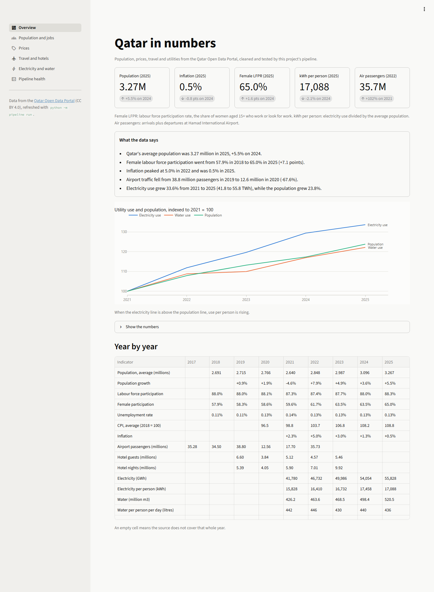
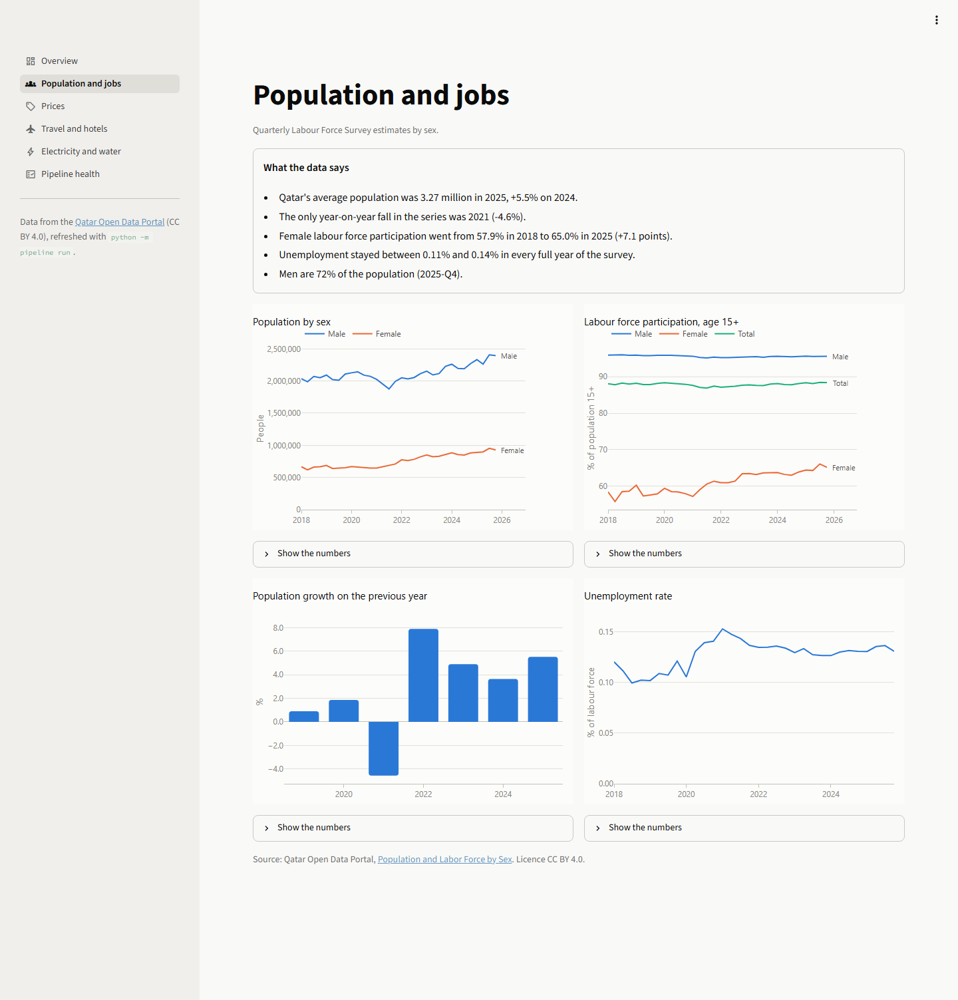
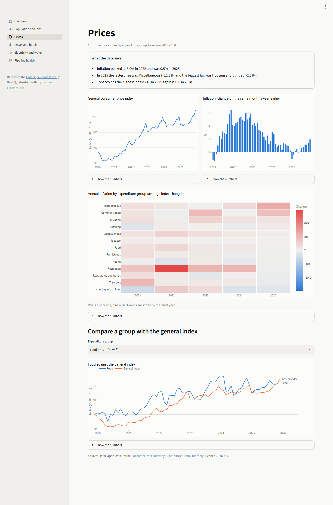
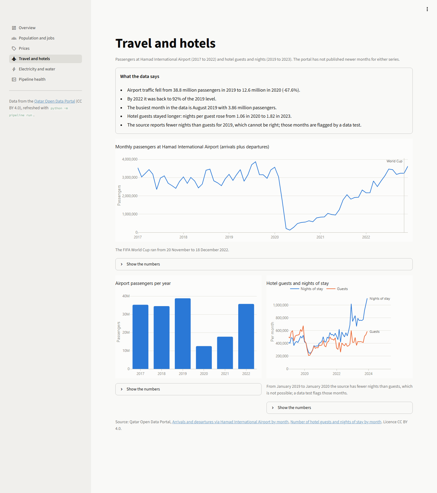
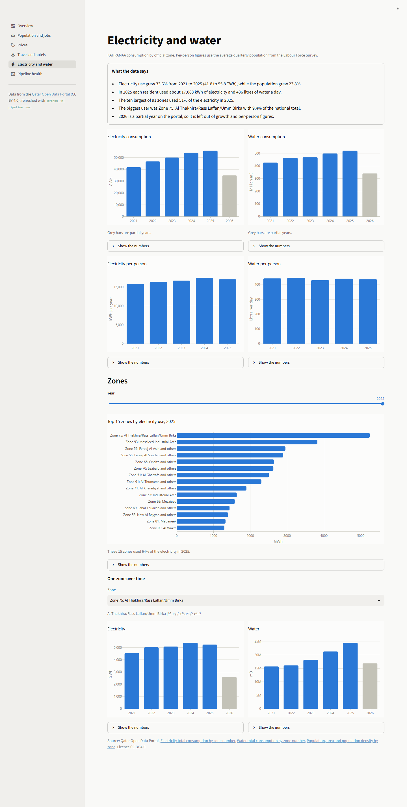
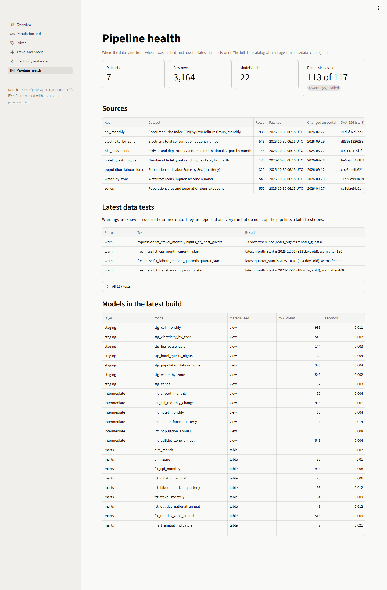
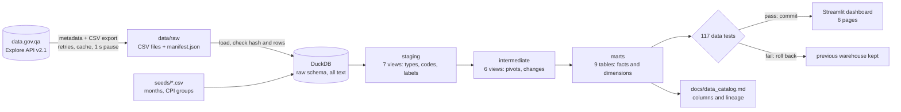

<p align="center">
  
</p>

**An end-to-end data pipeline that downloads official statistics from Qatar's open data portal, cleans and tests them in a layered DuckDB warehouse, and presents them in a Streamlit dashboard.**

<p>
  
  
  
  
  
  
  
</p>

| You want... | Go to |
| --- | --- |
| the findings | [Findings](#findings) |
| to run it | [Quick start](#quick-start) |
| to learn how a data pipeline is put together | [How it works](#how-it-works) |

## Why

Qatar publishes a lot of useful open data: around 2,000 datasets on
[data.gov.qa](https://www.data.gov.qa) from the National Planning Council,
KAHRAMAA, ministries and others. But each dataset is its own small table with
its own layout. Months are written as "Jan" in one file and "January" in
another, a year and a measure share one column ("2021&nbsp;&nbsp;Guests"), column
names are transliterated from Arabic (`lmw_shr`, `ljns`), some series stopped
updating years ago, and the running year sits next to complete years without a
flag. Answering a simple question such as "is electricity use growing faster
than the population?" means downloading several files and fixing all of that
by hand.

This project does that work once, in code, with tests, so the answer can be
rebuilt with one command whenever the portal updates.

## Findings

All numbers below come from the warehouse built on 30 October 2026. The
dashboard computes the same sentences live from the data, so they update when
the portal does.

| Topic | Finding |
| --- | --- |
| Population | The average population was **3.27 million in 2025, up 5.5%** on 2024. The only fall since 2018 was in 2021 (**-4.6%**, during the pandemic); it grew again by 7.9% in 2022. |
| Who lives here | Men are **72%** of the population (2025 Q4). |
| Women at work | Female labour force participation rose from **57.9% in 2018 to 65.0% in 2025** (+7.1 points). Overall participation stays near 88% and unemployment between **0.11% and 0.14%** in every year. |
| Prices | Annual inflation peaked at **5.0% in 2022** (the monthly high was 6.5% year on year in December 2021) and slowed to **0.5% in 2025**. Recreation and culture prices rose **29.6% in 2022**, the World Cup year. In 2025 the biggest rise was miscellaneous goods and services (+12.3%) and housing and utilities fell 2.3%. The tobacco index stands at 246 (2018 = 100). |
| Air travel | Passengers at Hamad International Airport fell **67.6%**, from 38.8 million in 2019 to 12.6 million in 2020. By 2022 traffic was back to 35.7 million, **92% of the 2019 level**. December 2022, the World Cup month, had 3.62 million passengers (+56% on December 2021). |
| Hotels | Guests are staying longer: nights per guest rose from **1.06 in 2020 to 1.82 in 2023**, and 2023 had 9.92 million hotel nights, the most in the data. |
| Electricity | Consumption grew **33.6%** from 41.8 TWh (2021) to 55.8 TWh (2025) while the population grew **23.8%**, so use per resident rose from 15,828 to **17,088 kWh** (+8.0%). |
| Water | Water use grew 22.1% (426 to 521 million m3), close to population growth: about **436 litres per resident per day** in 2025. |
| Where the power goes | The 10 largest of 91 zones used **51%** of the electricity in 2025. The largest is zone 75 (Al Thakhira, Ras Laffan, Umm Birka) with **9.4%**, then zone 93 (Mesaieed Industrial Area) with 6.8%. |

Per-resident utility figures divide total consumption, including industry, by
the population, so they are not household consumption. See the [FAQ](#faq).

## Pipeline numbers

Measured on a Windows 11 laptop on 30 October 2026.

| Measure | Value |
| --- | --- |
| Datasets | 7 (6 statistical datasets and 1 zone lookup table) |
| Raw rows | 3,164 rows, 192 KB of CSV |
| Requests for a full download | 14 (metadata and export for each dataset, 1 s apart) |
| Full run from an empty folder | 62.5 s: 61.5 s waiting on the portal, 1.0 s to build and test |
| Run with a fresh cache | 0.6 s, no requests |
| Warehouse size after a fresh build | 6.0 MB |
| SQL models | 22 (7 staging, 6 intermediate, 9 marts) plus 2 seed tables |
| Data tests per run | 117: 113 pass, 4 warnings (known source issues), 0 failures |
| Unit tests | 96, about 7 s, no network access |
| Code | 720 lines of SQL, about 3,000 lines of Python, 1,370 lines of tests |

## Screenshots

Real screenshots of the dashboard, taken with `python scripts/screenshots.py`.

| | |
| --- | --- |
| <br>**Overview**: headline figures, findings, and utility use against population on one indexed axis. | <br>**Population and jobs**: quarterly population by sex, participation and unemployment. |
| <br>**Prices**: general CPI, monthly inflation and a heatmap of annual inflation by group. | <br>**Travel and hotels**: the 2020 collapse, the recovery and the World Cup month. |
| <br>**Electricity and water**: national totals, per-resident use and a zone explorer with Arabic names. | <br>**Pipeline health**: sources, fetch times, file hashes and the latest data test results. |

## How it works



**1. Extract** ([`pipeline/extract.py`](pipeline/extract.py)). For each dataset in
[`config/sources.yml`](config/sources.yml) the extractor asks the portal for the
dataset's metadata and, only if the data changed since the last download, its
CSV export. Requests go out one at a time with a 1 second pause, failed
requests are retried with exponential backoff (honouring `Retry-After`), and a
file younger than 24 hours is reused without any request. Each file is checked
against a column contract and a minimum row count before it replaces the old
one. `data/raw/manifest.json` records the source URL, fetch time, row count and
SHA-256 hash of every file.

**2. Load** ([`pipeline/load.py`](pipeline/load.py)). Raw files are loaded into
DuckDB unchanged, every column as text. The loader refuses a file whose hash or
row count does not match the manifest.

**3. Transform** ([`pipeline/transform.py`](pipeline/transform.py), [`models/`](models)).
One SQL file per model, in three layers. Models refer to each other with
`{{ ref('...') }}`, `{{ source('...') }}` and `{{ seed('...') }}`; a small runner
reads those references, sorts the models into dependency order and creates
each one as a view or a table. A model can only depend on its own layer or an
earlier one.

| Layer | What happens there | Examples |
| --- | --- | --- |
| staging | Types, codes and labels. Months like "Jan" and "April" become dates, "2021&nbsp;&nbsp;Guests" is split into a year and a measure, CPI group "0" becomes "000", typos in English labels are replaced from a seed table, Arabic labels are kept with clean spacing. | `stg_cpi_monthly`, `stg_hotel_guests_nights` |
| intermediate | Reshaping and calculations: pivots, male plus female totals, month-on-month and year-on-year changes (joined on the calendar, never on row position), annual population, complete-year flags. | `int_labour_force_quarterly`, `int_utilities_zone_annual` |
| marts | Tables for analysis: facts per month, quarter or year, two dimensions (`dim_month`, `dim_zone`) and a one-row-per-year summary that combines every dataset. | `fct_utilities_national_annual`, `mart_annual_indicators` |

**4. Test** ([`pipeline/quality.py`](pipeline/quality.py), [`models/schema.yml`](models/schema.yml)).
117 data tests: not null, unique keys, accepted values, ranges, row counts,
relationships, row-level rules (for example population 15+ must equal active
plus inactive), custom SQL checks and freshness. Tests marked `warn` report
known problems in the source without stopping the run.

The whole build follows a **write, audit, publish** pattern: loading, all 22
models and all tests run inside one DuckDB transaction, and the transaction is
only committed when no error-level test fails. If the portal ever publishes a
broken file, the run stops with a clear message and the dashboard keeps showing
the last good data. Test results are stored in `audit.check_results` either way.

**5. Present.** The [Streamlit dashboard](dashboard) reads only the marts. Each
chart has a "Show the numbers" table under it, and the written findings on each
page are computed from the data when the page loads.
[`docs/data_catalog.md`](docs/data_catalog.md) is generated from the warehouse
and lists every model, column, type and test, with a lineage graph.

## Quick start

You need Python 3.11 or newer. Everything works the same in PowerShell, cmd or
bash; `tasks.py` replaces a Makefile.

```bash
git clone <this repository>
cd qatar-open-data-pipeline
python -m venv .venv
.venv\Scripts\activate            # macOS / Linux: source .venv/bin/activate
python tasks.py setup             # pip install -r requirements-dev.txt

python -m pipeline run            # download, build and test (about a minute)
python tasks.py dashboard         # open http://localhost:8501
```

The pipeline commands:

| Command | What it does |
| --- | --- |
| `python -m pipeline run` | Extract, build and test. The normal command. `--skip-extract` works offline from `data/raw`, `--force` downloads everything again. |
| `python -m pipeline extract` | Download raw files only. `--only cpi_monthly` for one dataset. |
| `python -m pipeline transform` | Load raw files and build the models (no tests). `--select fct_cpi_monthly` builds one model and its parents. |
| `python -m pipeline test` | Run the data tests against the current warehouse. Exits with code 1 on failure. |
| `python -m pipeline docs` | Regenerate `docs/data_catalog.md`. |
| `python -m pipeline sources` | List the configured datasets. |

Development tasks: `python tasks.py test` (pytest), `python tasks.py lint`
(ruff), `python tasks.py help` for the full list.

**With Docker:**

```bash
docker compose up --build         # runs the pipeline, then serves the dashboard on :8501
docker compose run --rm pipeline  # refresh the data later
```

The `pipeline` service writes to a named volume and exits; the `dashboard`
service only starts if the pipeline finished successfully and mounts the volume
read-only.

## Datasets

All data comes from the [Qatar Open Data Portal](https://www.data.gov.qa) through
its Opendatasoft Explore API v2.1. The portal publishes these datasets under the
[Creative Commons Attribution 4.0 licence (CC BY 4.0)](https://creativecommons.org/licenses/by/4.0/)
(the licence field in each dataset's metadata). The raw files are not stored in
this repository; the pipeline downloads them. The test fixtures in
`tests/fixtures/raw` are small excerpts of the same data, under the same licence.

| Key | Dataset | Publisher | Coverage | Rows |
| --- | --- | --- | --- | ---: |
| `population_labour_force` | [Population and Labor Force by Sex](https://www.data.gov.qa/explore/dataset/population-and-labour-force-by-gender-quarterly/) | National Planning Council | Quarterly, 2018 Q1 to 2025 Q4 | 320 |
| `cpi_monthly` | [Consumer Price Index by Expenditure Group, monthly](https://www.data.gov.qa/explore/dataset/consumer-price-index-cpi-by-expenditure-group-monthly/) | National Planning Council | Monthly, Jan 2020 to Dec 2025 | 936 |
| `hia_passengers` | [Arrivals and departures via Hamad International Airport by month](https://www.data.gov.qa/explore/dataset/arrival-and-departures-via-hamad-international-airport-by-month-and-year/) | National Planning Council | Monthly, Jan 2017 to Dec 2022 | 144 |
| `hotel_guests_nights` | [Number of hotel guests and nights of stay by month](https://www.data.gov.qa/explore/dataset/number-of-hotel-guests-and-nights-of-stay-by-month/) | National Planning Council | Monthly, Jan 2019 to Dec 2023 | 120 |
| `electricity_by_zone` | [Electricity total consumption by zone number](https://www.data.gov.qa/explore/dataset/electricity-total-consumption-by-zone-number/) | KAHRAMAA | Annual by zone, 2021 to 2026 (2026 partial) | 546 |
| `water_by_zone` | [Water total consumption by zone number](https://www.data.gov.qa/explore/dataset/water-total-consumption-by-zone-number/) | KAHRAMAA | Annual by zone, 2021 to 2026 (2026 partial) | 546 |
| `zones` | [Population, area and population density by zone](https://www.data.gov.qa/explore/dataset/population-area-and-population-density-per-square-kilometers-by-zone/) | National Planning Council | Zone names in English and Arabic (lookup only) | 552 |

Attribution: Qatar Open Data Portal, National Planning Council and KAHRAMAA.

### Known issues in the source data

The pipeline keeps these visible instead of hiding them:

- **Hotel nights below guests.** From January 2019 to January 2020 the published
  nights are lower than the guests (0.82 nights per guest in 2019), which cannot
  be right. A `warn` test flags the 13 months and the dashboard says so.
- **Stale series.** Airport passengers stop in December 2022 and hotel figures in
  December 2023. CPI ends in December 2025 and the labour survey in 2025 Q4.
  Freshness tests warn about each one.
- **Partial year.** KAHRAMAA publishes the running year as a partial total
  (January to August for 2026). The pipeline marks a year complete only if the
  file was downloaded after the year ended, and leaves partial years out of
  growth rates and per-resident figures.
- **Labels.** English CPI group names contain typos ("Resturant", "gooda"), the
  general index is coded "0" while the groups use "001" to "012", and several
  columns are transliterated from Arabic. The staging layer fixes these and the
  [data catalog](docs/data_catalog.md) lists the portal's own English and Arabic
  label for every raw column.

## Project structure

```
config/sources.yml      datasets to download and their column contracts
pipeline/               extract, load, model runner, data tests, docs, CLI
models/staging/         one SQL file per model ...
models/intermediate/
models/marts/
models/schema.yml       data tests and column descriptions
seeds/                  small lookup tables (months, CPI groups)
dashboard/              Streamlit app: app.py, views/, charts, findings
tests/                  pytest suite and trimmed real-data fixtures
scripts/                fixtures, screenshots and banner helpers
docs/                   generated data catalog and images
tasks.py                cross-platform task runner
Dockerfile, docker-compose.yml
```

## Roadmap

- [x] Polite extractor with retries, caching, change detection and a manifest
- [x] Layered SQL models with a dependency-aware runner
- [x] Data tests with warn and error levels, run inside the build transaction
- [x] Generated data catalog with lineage
- [x] Dashboard with written findings and table views
- [x] Docker setup
- [ ] Scheduled refresh (Windows Task Scheduler or a CI job) with a change log of what the portal updated
- [ ] More datasets: GDP by activity, vehicle registrations, births and deaths
- [ ] Arabic interface for the dashboard (right-to-left layout)
- [ ] Zone-level population from the 2020 census for per-resident figures by zone
- [ ] Export the marts to Parquet for use in Power BI or Excel
- [ ] Anomaly checks on monthly series (sudden jumps reported as warnings)

## FAQ

**Is "electricity per resident" what a household uses?**
No. KAHRAMAA's zone totals include industry (the two largest zones are Ras
Laffan and Mesaieed, both industrial areas), so the figure is national
consumption divided by the number of residents. It is useful for trends, not
for comparing with household bills.

**Why are recent years missing for travel?**
The portal has not published airport passengers after 2022 or hotel figures
after 2023. The pipeline shows what exists and the freshness tests warn about
the gap; it does not fill it with estimates.

**Why DuckDB?**
The data is small, the warehouse is a single file, it needs no server, and its
SQL handles dates, pivots and window functions well. The same models would run
on Postgres or a cloud warehouse with minor changes.

**Why not dbt?**
dbt would work well here (dbt-duckdb exists). A small runner keeps the project
dependency-light and shows how ref-based dependency ordering works. The model
files use the same `{{ ref() }}` style, so moving to dbt later is mostly
configuration.

**Does it put load on the portal?**
A full download is 14 requests, sent one at a time with a pause in between. After
that, a run within 24 hours makes no requests, and later runs only download a
dataset again if its metadata says the data changed.

**Can I run it without internet?**
Yes, once the files are in `data/raw`: `python -m pipeline run --skip-extract`.
The unit tests never use the network; they run against trimmed copies of the
real files in `tests/fixtures/raw`.

## Contributing

Issues and pull requests are welcome. [CONTRIBUTING.md](CONTRIBUTING.md) explains
the setup and walks through adding a new dataset step by step.

## License

The code is released under the [MIT License](LICENSE), Copyright (c) 2026
Mohaned Elhagar. The data belongs to its publishers and is used under the
portal's terms (CC BY 4.0); this licence does not cover it.
