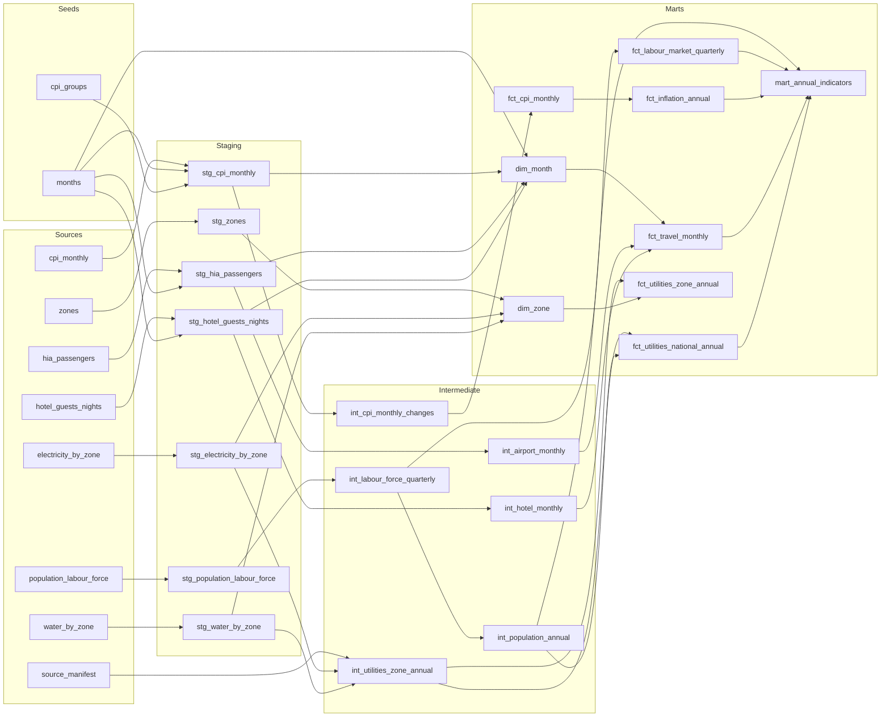

# Data catalog

Generated by `python -m pipeline docs` on 2026-10-31. Do not edit by hand.

Source data: [Qatar Open Data Portal](https://www.data.gov.qa), licensed [CC BY 4.0](https://creativecommons.org/licenses/by/4.0/).

## Sources

| Key | Dataset | Publisher | Rows | Fetched (UTC) |
| --- | --- | --- | ---: | --- |
| `population_labour_force` | [Population and Labor Force by Sex (quarterly)](https://www.data.gov.qa/explore/dataset/population-and-labour-force-by-gender-quarterly/) | National Planning Council | 320 | 2026-10-31 09:59 |
| `cpi_monthly` | [Consumer Price Index (CPI) by Expenditure Group, monthly](https://www.data.gov.qa/explore/dataset/consumer-price-index-cpi-by-expenditure-group-monthly/) | National Planning Council | 936 | 2026-10-31 09:59 |
| `hia_passengers` | [Arrivals and departures via Hamad International Airport by month](https://www.data.gov.qa/explore/dataset/arrival-and-departures-via-hamad-international-airport-by-month-and-year/) | National Planning Council | 144 | 2026-10-31 09:59 |
| `hotel_guests_nights` | [Number of hotel guests and nights of stay by month](https://www.data.gov.qa/explore/dataset/number-of-hotel-guests-and-nights-of-stay-by-month/) | National Planning Council | 120 | 2026-10-31 09:59 |
| `electricity_by_zone` | [Electricity total consumption by zone number](https://www.data.gov.qa/explore/dataset/electricity-total-consumption-by-zone-number/) | KAHRAMAA | 546 | 2026-10-31 09:59 |
| `water_by_zone` | [Water total consumption by zone number](https://www.data.gov.qa/explore/dataset/water-total-consumption-by-zone-number/) | KAHRAMAA | 546 | 2026-10-31 09:59 |
| `zones` | [Population, area and population density by zone](https://www.data.gov.qa/explore/dataset/population-area-and-population-density-per-square-kilometers-by-zone/) | National Planning Council | 552 | 2026-10-31 09:59 |

### Raw column labels

The portal derives some column names from Arabic labels (`lmw_shr`, `ljns`...). These are the labels it publishes for each raw column.

**population_labour_force**

| Column | Type | Label (EN) | Label (AR) |
| --- | --- | --- | --- |
| `year` | date | Year | السنة |
| `quarter` | text | Quarter | الربع السنوي |
| `gender` | text | Gender | الجنس |
| `ljns` | text | الجنس | الجنس |
| `indicator` | text | Indicator | المؤشر |
| `lmw_shr` | text | المؤشر | المؤشر |
| `number` | int | Number | العدد |

**cpi_monthly**

| Column | Type | Label (EN) | Label (AR) |
| --- | --- | --- | --- |
| `year` | date | Year | السنة |
| `month` | text | Month | الشهر |
| `lshhr` | text | الشهر | الشهر |
| `group_code` | text | Group Code | رمز المجموعة |
| `group` | text | Group | المجموعة |
| `lmjmw` | text | المجموعة | المجموعة |
| `cpi_index` | double | CPI Index  | الرقم القياسي لأسعار المستهلك |

**hia_passengers**

| Column | Type | Label (EN) | Label (AR) |
| --- | --- | --- | --- |
| `year` | date | Year | السنة |
| `month` | text | Month | الشهر  |
| `lshhr` | text | الشهر  | الشهر  |
| `type` | text | Type | نوع |
| `nw` | text | نوع | نوع |
| `total` | int | Total | المجموع |

**hotel_guests_nights**

| Column | Type | Label (EN) | Label (AR) |
| --- | --- | --- | --- |
| `month` | text | Month | شهر |
| `month_ar` | text | الشهر | الشهر |
| `year` | text | Year | السنة الأكاديمية |
| `sn` | text | سنة | سنة |
| `value` | double | Value | القيمة |

**electricity_by_zone**

| Column | Type | Label (EN) | Label (AR) |
| --- | --- | --- | --- |
| `year` | date | Year | السنة |
| `zone_number` | text | Zone Number | رقم المنطقة |
| `value` | int | Value | القيمة |

**water_by_zone**

| Column | Type | Label (EN) | Label (AR) |
| --- | --- | --- | --- |
| `year` | date | Year | السنة |
| `zone_number` | text | Zone Number | رقم المنطقة |
| `value` | int | Value | القيمة |

**zones**

| Column | Type | Label (EN) | Label (AR) |
| --- | --- | --- | --- |
| `year` | text | Year | السنة |
| `number_of_zone` | text | Number of zone | Number of zone |
| `lmntq` | text | المنطقة | المنطقة |
| `zone` | text | Zone | Zone |
| `population` | double | Population | السكان |
| `area_in_km` | double | Area in Km | المساحة بالكيلو متر المربع |
| `population_density_km2` | double | Population Density Km2 | الكثافة السكانية في الكيلو متر المربع |

## Lineage

## Staging

### staging.stg_cpi_monthly

Monthly consumer price index by expenditure group (base 2018 = 100). The source mixes month abbreviations, writes the general index code as "0" and has typos in the English group names, so codes are padded to three digits and English names come from the cpi_groups seed.

view, 936 rows. Defined in [`models/staging/stg_cpi_monthly.sql`](../models/staging/stg_cpi_monthly.sql).

Table tests: `unique (month_start, group_code)`, `row_count`, `query: every_month_has_all_groups`

| Column | Type | Description | Tests |
| --- | --- | --- | --- |
| `month_start` | DATE |  | not_null |
| `year` | INTEGER |  |  |
| `month` | INTEGER |  |  |
| `group_code` | VARCHAR |  | not_null |
| `group_name_en` | VARCHAR |  | not_null |
| `group_short_name_en` | VARCHAR |  |  |
| `group_name_ar` | VARCHAR |  | not_null |
| `is_general_index` | BOOLEAN |  |  |
| `cpi_index` | DOUBLE |  | not_null, range |

### staging.stg_electricity_by_zone

Annual electricity consumption (kWh) per official zone, as published by KAHRAMAA. The most recent year is partial; completeness is decided later in the intermediate layer.

view, 546 rows. Defined in [`models/staging/stg_electricity_by_zone.sql`](../models/staging/stg_electricity_by_zone.sql).

Table tests: `unique (year, zone_number)`, `row_count`

| Column | Type | Description | Tests |
| --- | --- | --- | --- |
| `year` | INTEGER |  | not_null, range |
| `zone_number` | INTEGER |  | not_null, range |
| `electricity_kwh` | BIGINT |  | not_null, range |

### staging.stg_hia_passengers

Monthly passengers through Hamad International Airport. One row per month and direction (arrivals or departures). Transit passengers are not part of this dataset.

view, 144 rows. Defined in [`models/staging/stg_hia_passengers.sql`](../models/staging/stg_hia_passengers.sql).

Table tests: `unique (month_start, direction)`, `row_count`

| Column | Type | Description | Tests |
| --- | --- | --- | --- |
| `month_start` | DATE |  | not_null |
| `year` | INTEGER |  |  |
| `month` | INTEGER |  |  |
| `direction` | VARCHAR |  | not_null, accepted_values |
| `direction_ar` | VARCHAR |  |  |
| `passengers` | BIGINT |  | not_null, range |

### staging.stg_hotel_guests_nights

Monthly hotel guests and nights of stay. In the source the year and the measure share one text column ("2021  Guests", "2021 Nights", with uneven spacing), so both are parsed out here. Values arrive as "499407.0".

view, 120 rows. Defined in [`models/staging/stg_hotel_guests_nights.sql`](../models/staging/stg_hotel_guests_nights.sql).

Table tests: `unique (month_start, measure)`, `row_count`

| Column | Type | Description | Tests |
| --- | --- | --- | --- |
| `month_start` | DATE |  | not_null |
| `year` | INTEGER |  |  |
| `month` | INTEGER |  |  |
| `measure` | VARCHAR |  | not_null, accepted_values |
| `measure_ar` | VARCHAR |  |  |
| `value` | BIGINT |  | not_null, range |

### staging.stg_population_labour_force

Quarterly population and labour force counts by sex from the Labour Force Survey. One row per quarter, sex and indicator. Free-text labels are mapped to stable codes; the Arabic labels from the source are kept.

view, 320 rows. Defined in [`models/staging/stg_population_labour_force.sql`](../models/staging/stg_population_labour_force.sql).

Table tests: `unique (year, quarter, sex, indicator)`, `row_count`, `query: every_quarter_has_all_indicators`

| Column | Type | Description | Tests |
| --- | --- | --- | --- |
| `year` | INTEGER |  | not_null, range |
| `quarter` | INTEGER |  | not_null, range |
| `quarter_start` | DATE |  |  |
| `quarter_label` | VARCHAR |  |  |
| `sex` | VARCHAR |  | not_null, accepted_values |
| `sex_ar` | VARCHAR |  |  |
| `indicator` | VARCHAR |  | not_null, accepted_values |
| `indicator_en` | VARCHAR |  |  |
| `indicator_ar` | VARCHAR |  |  |
| `persons` | BIGINT |  | not_null, range |

### staging.stg_water_by_zone

Annual water consumption (cubic metres) per official zone, as published by KAHRAMAA. Same layout and coverage as the electricity file.

view, 546 rows. Defined in [`models/staging/stg_water_by_zone.sql`](../models/staging/stg_water_by_zone.sql).

Table tests: `unique (year, zone_number)`, `row_count`

| Column | Type | Description | Tests |
| --- | --- | --- | --- |
| `year` | INTEGER |  | not_null, range |
| `zone_number` | INTEGER |  | not_null, range |
| `water_m3` | BIGINT |  | not_null, range |

### staging.stg_zones

One row per official zone with its English and Arabic name. The source repeats each zone for several years, so the name from the latest year wins. Population columns are ignored: they stop in 2019 and are mostly empty.

view, 92 rows. Defined in [`models/staging/stg_zones.sql`](../models/staging/stg_zones.sql).

| Column | Type | Description | Tests |
| --- | --- | --- | --- |
| `zone_number` | INTEGER |  | not_null, unique |
| `zone_name_en` | VARCHAR |  | not_null |
| `zone_name_ar` | VARCHAR |  | not_null |

## Intermediate

### intermediate.int_airport_monthly

Hamad International Airport passengers per month with arrivals and departures side by side. Total passengers = arrivals + departures (transit passengers are not in this dataset).

view, 72 rows. Defined in [`models/intermediate/int_airport_monthly.sql`](../models/intermediate/int_airport_monthly.sql).

Table tests: `expression: passengers_is_arrivals_plus_departures`

| Column | Type | Description | Tests |
| --- | --- | --- | --- |
| `month_start` | DATE |  | not_null, unique |
| `arrivals` | HUGEINT |  |  |
| `departures` | HUGEINT |  |  |
| `passengers` | HUGEINT |  |  |

### intermediate.int_cpi_monthly_changes

CPI with month-on-month and year-on-year changes per expenditure group. Changes come from joins on the calendar month rather than lag(), so a missing month gives NULL instead of comparing against the wrong month.

view, 936 rows. Defined in [`models/intermediate/int_cpi_monthly_changes.sql`](../models/intermediate/int_cpi_monthly_changes.sql).

Table tests: `unique (month_start, group_code)`

| Column | Type | Description | Tests |
| --- | --- | --- | --- |
| `month_start` | DATE |  |  |
| `year` | INTEGER |  |  |
| `month` | INTEGER |  |  |
| `group_code` | VARCHAR |  |  |
| `group_name_en` | VARCHAR |  |  |
| `group_short_name_en` | VARCHAR |  |  |
| `group_name_ar` | VARCHAR |  |  |
| `is_general_index` | BOOLEAN |  |  |
| `cpi_index` | DOUBLE |  |  |
| `mom_change_pct` | DOUBLE |  |  |
| `yoy_change_pct` | DOUBLE |  |  |

### intermediate.int_hotel_monthly

Hotel guests and nights of stay per month side by side.

view, 60 rows. Defined in [`models/intermediate/int_hotel_monthly.sql`](../models/intermediate/int_hotel_monthly.sql).

| Column | Type | Description | Tests |
| --- | --- | --- | --- |
| `month_start` | DATE |  | not_null, unique |
| `guests` | HUGEINT |  | not_null |
| `nights` | HUGEINT |  | not_null |

### intermediate.int_labour_force_quarterly

Labour force indicators pivoted to one row per quarter and sex, plus a 'total' row per quarter that adds males and females together. Unemployed persons are derived as economically active minus employed.

view, 96 rows. Defined in [`models/intermediate/int_labour_force_quarterly.sql`](../models/intermediate/int_labour_force_quarterly.sql).

Table tests: `unique (quarter_start, sex)`, `expression: population_15_plus_is_active_plus_inactive`, `expression: employed_within_active`, `expression: adults_within_population`

| Column | Type | Description | Tests |
| --- | --- | --- | --- |
| `year` | INTEGER |  |  |
| `quarter` | INTEGER |  |  |
| `quarter_start` | DATE |  |  |
| `quarter_label` | VARCHAR |  |  |
| `sex` | VARCHAR |  |  |
| `sex_en` | VARCHAR |  |  |
| `sex_ar` | VARCHAR |  |  |
| `population` | BIGINT |  |  |
| `population_15_plus` | BIGINT |  |  |
| `economically_active` | BIGINT |  |  |
| `economically_inactive` | BIGINT |  |  |
| `employed` | BIGINT |  |  |
| `unemployed` | BIGINT |  |  |

### intermediate.int_population_annual

Annual population used as the denominator for per-capita figures: the average of the quarterly survey estimates in each year. A year only counts as complete when all four quarters are published.

view, 8 rows. Defined in [`models/intermediate/int_population_annual.sql`](../models/intermediate/int_population_annual.sql).

| Column | Type | Description | Tests |
| --- | --- | --- | --- |
| `year` | INTEGER |  | not_null, unique |
| `quarters_reported` | BIGINT |  | range |
| `is_complete_year` | BOOLEAN |  |  |
| `avg_population` | DOUBLE |  | not_null, range |
| `latest_quarter_population` | BIGINT |  |  |
| `avg_population_15_plus` | DOUBLE |  |  |

### intermediate.int_utilities_zone_annual

Electricity and water consumption per zone and year in one row. A year is complete only if the file was downloaded after that year ended: KAHRAMAA publishes the running year as a partial total (January to August for 2026), and comparing it with full years would look like a collapse.

view, 546 rows. Defined in [`models/intermediate/int_utilities_zone_annual.sql`](../models/intermediate/int_utilities_zone_annual.sql).

Table tests: `unique (year, zone_number)`

| Column | Type | Description | Tests |
| --- | --- | --- | --- |
| `year` | INTEGER |  |  |
| `zone_number` | INTEGER |  |  |
| `electricity_kwh` | BIGINT |  | not_null |
| `water_m3` | BIGINT |  | not_null |
| `is_complete_year` | BOOLEAN |  |  |

## Marts

### marts.dim_month

Calendar of months covering every monthly dataset, with English and Arabic month names. Monthly facts join to it on month_start.

table, 108 rows. Defined in [`models/marts/dim_month.sql`](../models/marts/dim_month.sql).

| Column | Type | Description | Tests |
| --- | --- | --- | --- |
| `month_start` | DATE | First day of the month; join key for monthly facts. | not_null, unique |
| `year` | BIGINT |  |  |
| `quarter` | BIGINT |  |  |
| `month` | BIGINT |  |  |
| `year_month` | VARCHAR | Text label YYYY-MM. |  |
| `month_abbr` | VARCHAR |  |  |
| `month_name_en` | VARCHAR |  |  |
| `month_name_ar` | VARCHAR | Arabic month name, in the form the portal uses (يناير, فبراير...). | not_null |

### marts.dim_zone

Zone dimension with English and Arabic names. Many zones group several districts ("Leabaib / Al Ebb / ..."), so a short name (first district) is added for charts. Zones that appear in the utility files but not in the names table still get a row so joins never drop consumption.

table, 92 rows. Defined in [`models/marts/dim_zone.sql`](../models/marts/dim_zone.sql).

| Column | Type | Description | Tests |
| --- | --- | --- | --- |
| `zone_number` | INTEGER | Official zone number (1 to 98). | not_null, unique |
| `zone_name_en` | VARCHAR | Full English name; multi-district zones list every district. |  |
| `zone_name_ar` | VARCHAR | Full Arabic name. |  |
| `zone_short_name_en` | VARCHAR | First district in the zone name, for charts. |  |
| `zone_short_name_ar` | VARCHAR |  |  |
| `zone_label` | VARCHAR | Display label such as: Zone 70: Leabaib and others. | not_null, unique |
| `has_name` | BOOLEAN | False when the zone appears in the utility files but not in the names table. | accepted_values |

### marts.fct_cpi_monthly

Monthly CPI per expenditure group with month-on-month and year-on-year changes (base 2018 = 100). One row per month and group.

table, 936 rows. Defined in [`models/marts/fct_cpi_monthly.sql`](../models/marts/fct_cpi_monthly.sql).

Table tests: `unique (month_start, group_code)`, `freshness (month_start)`

| Column | Type | Description | Tests |
| --- | --- | --- | --- |
| `month_start` | DATE |  |  |
| `year` | INTEGER |  |  |
| `month` | INTEGER |  |  |
| `group_code` | VARCHAR | Three-digit expenditure group code; 000 is the general index. |  |
| `group_name_en` | VARCHAR | Cleaned English group name (from seeds/cpi_groups.csv). |  |
| `group_short_name_en` | VARCHAR |  |  |
| `group_name_ar` | VARCHAR | Arabic group name from the source, whitespace normalised. |  |
| `is_general_index` | BOOLEAN |  |  |
| `cpi_index` | DOUBLE | Index value, base year 2018 = 100. | anomaly |
| `mom_change_pct` | DOUBLE | Change against the previous month, in percent. |  |
| `yoy_change_pct` | DOUBLE | Change against the same month a year earlier, in percent. | range |

### marts.fct_inflation_annual

Annual inflation per expenditure group. Two common measures: avg_inflation_pct: change in the 12-month average index (needs two full years) dec_on_dec_pct:    change from December of last year to December Years with fewer than 12 months of data get NULL changes.

table, 78 rows. Defined in [`models/marts/fct_inflation_annual.sql`](../models/marts/fct_inflation_annual.sql).

Table tests: `unique (year, group_code)`

| Column | Type | Description | Tests |
| --- | --- | --- | --- |
| `year` | INTEGER |  |  |
| `group_code` | VARCHAR |  |  |
| `group_name_en` | VARCHAR |  |  |
| `group_short_name_en` | VARCHAR |  |  |
| `group_name_ar` | VARCHAR |  |  |
| `is_general_index` | BOOLEAN |  |  |
| `months_reported` | BIGINT | Months of data in the year; changes need 12. | range |
| `avg_index` | DOUBLE | Average of the monthly index values. |  |
| `december_index` | DOUBLE |  |  |
| `avg_inflation_pct` | DOUBLE | Change in the annual average index against the previous year. |  |
| `dec_on_dec_pct` | DOUBLE | December index against the previous December. |  |

### marts.fct_labour_market_quarterly

Quarterly labour market indicators by sex (male, female, total) with the standard rates: participation rate     = economically active / population 15+ unemployment rate      = unemployed / economically active employment-to-pop rate = employed / population 15+ Population growth compares with the same quarter one year earlier.

table, 96 rows. Defined in [`models/marts/fct_labour_market_quarterly.sql`](../models/marts/fct_labour_market_quarterly.sql).

Table tests: `unique (quarter_start, sex)`, `freshness (quarter_start)`

| Column | Type | Description | Tests |
| --- | --- | --- | --- |
| `quarter_start` | DATE | First day of the survey quarter. |  |
| `year` | INTEGER |  |  |
| `quarter` | INTEGER |  |  |
| `quarter_label` | VARCHAR |  |  |
| `sex` | VARCHAR | male, female or total (sum of both). | accepted_values |
| `sex_en` | VARCHAR |  |  |
| `sex_ar` | VARCHAR |  |  |
| `population` | BIGINT | Total population (all ages). |  |
| `population_15_plus` | BIGINT | Population aged 15 and above. |  |
| `economically_active` | BIGINT | Labour force aged 15+ (employed plus unemployed). |  |
| `economically_inactive` | BIGINT |  |  |
| `employed` | BIGINT |  |  |
| `unemployed` | BIGINT | Economically active minus employed. |  |
| `participation_rate_pct` | DOUBLE | Economically active / population 15+, in percent. | not_null, range |
| `unemployment_rate_pct` | DOUBLE | Unemployed / economically active, in percent. | not_null, range |
| `employment_to_population_pct` | DOUBLE | Employed / population 15+, in percent. |  |
| `population_yoy_pct` | DOUBLE | Change in population against the same quarter a year earlier. | range |

### marts.fct_travel_monthly

Monthly travel and tourism activity: Hamad International Airport passengers and hotel guests / nights on one calendar. The two sources cover different periods (airport 2017-2022, hotels 2019-2023), so a column is NULL where its source has no data for that month.

table, 84 rows. Defined in [`models/marts/fct_travel_monthly.sql`](../models/marts/fct_travel_monthly.sql).

Table tests: `unique (month_start)`, `expression: nights_at_least_guests`, `freshness (month_start)`

| Column | Type | Description | Tests |
| --- | --- | --- | --- |
| `month_start` | DATE |  |  |
| `year` | BIGINT |  |  |
| `month` | BIGINT |  |  |
| `year_month` | VARCHAR |  |  |
| `month_name_en` | VARCHAR |  |  |
| `month_name_ar` | VARCHAR |  |  |
| `airport_arrivals` | HUGEINT | Arriving passengers at Hamad International Airport. |  |
| `airport_departures` | HUGEINT | Departing passengers at Hamad International Airport. |  |
| `airport_passengers` | HUGEINT | Arrivals plus departures (no transit). | range, anomaly |
| `hotel_guests` | HUGEINT | Hotel guests in the month. | anomaly |
| `hotel_nights` | HUGEINT | Nights of stay in the month. | anomaly |
| `nights_per_guest` | DOUBLE | Hotel nights divided by hotel guests. |  |
| `airport_passengers_yoy_pct` | DOUBLE | Change against the same month a year earlier. |  |
| `hotel_guests_yoy_pct` | DOUBLE | Change against the same month a year earlier. |  |

### marts.fct_utilities_national_annual

National electricity and water consumption per year, with per-capita figures based on the average quarterly population. Per-capita values and growth rates are left NULL for partial years, which would otherwise look like a sharp drop.

table, 6 rows. Defined in [`models/marts/fct_utilities_national_annual.sql`](../models/marts/fct_utilities_national_annual.sql).

Table tests: `expression: most_zones_reported`, `expression: no_per_capita_for_partial_years`

| Column | Type | Description | Tests |
| --- | --- | --- | --- |
| `year` | INTEGER |  | not_null, unique |
| `is_complete_year` | BOOLEAN | False for the running year (partial totals). |  |
| `zones_reported` | BIGINT |  |  |
| `electricity_kwh` | HUGEINT |  |  |
| `electricity_gwh` | DOUBLE |  |  |
| `water_m3` | HUGEINT |  |  |
| `water_million_m3` | DOUBLE |  |  |
| `avg_population` | DOUBLE | Average of the four quarterly population estimates. |  |
| `electricity_kwh_per_capita` | DOUBLE | Electricity kWh per resident (complete years only). | range |
| `water_m3_per_capita` | DOUBLE | Water cubic metres per resident (complete years only). |  |
| `water_litres_per_capita_per_day` | DOUBLE | Water litres per resident per day (complete years only). | range |
| `electricity_yoy_pct` | DOUBLE |  |  |
| `water_yoy_pct` | DOUBLE |  |  |

### marts.fct_utilities_zone_annual

Electricity and water consumption per zone and year, with each zone's share of the national total, its rank, and growth on the previous year. Growth is only filled when both years are complete.

table, 546 rows. Defined in [`models/marts/fct_utilities_zone_annual.sql`](../models/marts/fct_utilities_zone_annual.sql).

Table tests: `unique (year, zone_number)`

| Column | Type | Description | Tests |
| --- | --- | --- | --- |
| `year` | INTEGER |  |  |
| `zone_number` | INTEGER |  | not_null, relationships |
| `zone_label` | VARCHAR |  | not_null |
| `zone_name_en` | VARCHAR |  |  |
| `zone_name_ar` | VARCHAR |  |  |
| `is_complete_year` | BOOLEAN | False for the running year, which KAHRAMAA publishes as a partial total. |  |
| `electricity_kwh` | BIGINT | Electricity consumption in kWh. |  |
| `water_m3` | BIGINT | Water consumption in cubic metres. |  |
| `electricity_share_pct` | DOUBLE | Share of the national electricity total in that year. | range |
| `water_share_pct` | DOUBLE |  |  |
| `electricity_rank` | BIGINT | 1 = the zone with the highest consumption that year. |  |
| `electricity_yoy_pct` | DOUBLE | Change against the previous year (complete years only). |  |
| `water_yoy_pct` | DOUBLE |  |  |

### marts.mart_annual_indicators

Qatar at a glance: one row per year with a headline figure from every dataset. Each figure is only filled for years its source covers in full, so an annual total is never built from part of a year.

table, 9 rows. Defined in [`models/marts/mart_annual_indicators.sql`](../models/marts/mart_annual_indicators.sql).

| Column | Type | Description | Tests |
| --- | --- | --- | --- |
| `year` | BIGINT |  | not_null, unique |
| `avg_population` | DOUBLE | Average quarterly population (years with four quarters). |  |
| `population_growth_pct` | DOUBLE | Change in average population against the previous year. |  |
| `participation_rate_pct` | DOUBLE | Labour force participation, all quarters of the year pooled. |  |
| `female_participation_rate_pct` | DOUBLE | Female labour force participation, quarters pooled. |  |
| `unemployment_rate_pct` | DOUBLE | Unemployment rate, quarters pooled. | range |
| `cpi_avg_index` | DOUBLE |  |  |
| `cpi_inflation_pct` | DOUBLE | Change in the annual average general CPI. | range |
| `airport_passengers` | HUGEINT | Hamad International Airport passengers (years with 12 months). |  |
| `hotel_guests` | HUGEINT | Hotel guests (years with 12 months). |  |
| `hotel_nights` | HUGEINT |  |  |
| `electricity_gwh` | DOUBLE | National electricity consumption in GWh (complete years). |  |
| `electricity_kwh_per_capita` | DOUBLE | Electricity kWh per resident. |  |
| `water_million_m3` | DOUBLE |  |  |
| `water_litres_per_capita_per_day` | DOUBLE | Water litres per resident per day. |  |
